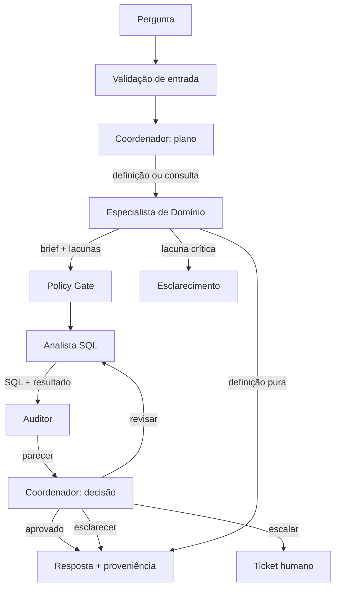

# Sistema Multiagente — Banco Aurora

[](https://colab.research.google.com/github/steingui/aurora-multiagente/blob/main/sistema_multiagente_aurora.ipynb)

Evolução de um agente único ReAct para um **sistema multiagente coordenado com LangGraph**.
O domínio é um data warehouse bancário fictício (Banco Aurora): o sistema responde
perguntas de negócio em linguagem natural, consulta SQL somente leitura e apresenta a
evidência usada na resposta.

O notebook foi construído para a **Entrega II** da disciplina *Agentes e Workflows com
LLM* e compara três configurações:

| Configuração | Descrição |
|---|---|
| **C1** | Loop ReAct manual da Entrega I |
| **C2** | O mesmo agente único dentro de um `StateGraph` do LangGraph |
| **C3** | Coordenador + Especialista de Domínio + Analista SQL + Auditor |

A comparação isola o ganho da **orquestração** (C1 → C2) e o ganho da **decomposição**
(C2 → C3).

## Arquitetura



### Agentes

| Agente | Responsabilidade | Ferramentas |
|---|---|---|
| **Coordenador** | Planeja, delega, controla orçamento e decide entre responder, revisar ou escalar | Nenhuma ferramenta de dados |
| **Especialista de Domínio** | Resolve métricas, definições, tabelas e ambiguidades; produz um *brief* estruturado | `inspecionar_schema`, `buscar_documentacao` |
| **Analista SQL** | Formula, executa e corrige SQL somente leitura; devolve SQL, resultado e hipóteses | `executar_sql` |
| **Auditor** | Verifica aderência pergunta–SQL–resultado e aprova ou pede revisão | Checagens determinísticas + LLM |

A decomposição segue responsabilidades reais, não ferramentas: o Analista SQL usa uma
ferramenta, mas sua responsabilidade inclui interpretar o brief, formular a consulta,
diagnosticar erros e corrigir. O Auditor existe para separar **quem executa** de **quem
verifica** (*maker-checker*).

### Coordenação e contratos

- **Envelopes** com `id`, `correlation_id`, remetente, destinatário, tipo, payload e
  proveniência.
- **Contratos Pydantic** em todas as fronteiras: `PlanoTarefa`, `BriefDominio`,
  `ArtefatoConsulta`, `ParecerVerificacao`.
- **Loop de revisão** com feedback específico do Auditor para o Analista, limitado por
  orçamento.
- **Checkpoint/replay** com `InMemorySaver` e `thread_id`.
- **Policy gate** antes do SQL, com tabelas permitidas, limite de linhas e mascaramento
  de PII.
- **Trilha de auditoria** append-only com todas as transições.
- **Preparação para governança:** classificação de risco, ponto de extensão para
  aprovação humana (`interrupt`) e persistência futura da auditoria.

## Como testar

### No Google Colab (recomendado)

1. Abra o notebook pelo badge acima.
2. Configure o secret `OPENROUTER_API_KEY` em **Secrets** (ícone de chave no painel
   esquerdo). A chave não deve ser escrita no notebook.
3. Execute **Runtime → Run all**.

Sem chave, a demo com LLM real é pulada automaticamente e os **10 testes offline**
rodam com `MockLLM`. Com chave, além dos testes, roda a demonstração real com OpenRouter.

### Localmente, sem chave

```bash
python -m venv .venv
source .venv/bin/activate
pip install -r requirements.txt nbformat nbconvert ipykernel

jupyter nbconvert --to notebook --execute --inplace \
  --ExecutePreprocessor.timeout=600 \
  --ExecutePreprocessor.kernel_name=python3 \
  sistema_multiagente_aurora.ipynb
```

A execução termina com:

```text
Testes offline: 10 / 10
Cenarios avaliados: 5
Chave configurada: False
```

### O que os testes cobrem

| Teste | O que valida |
|---|---|
| `contratos_e_envelopes` | Schemas Pydantic e envelope completo |
| `definicao_pura_sem_sql` | Pergunta de definição não executa SQL |
| `consulta_com_evidencia` | Fluxo completo com SQL, parecer e resposta |
| `auditor_forca_revisao` | Auditor reprova, coordenador envia feedback e analista corrige |
| `preservacao_nas_fronteiras` | Definições, SQL e resultado chegam ao auditor e à resposta |
| `bloqueio_destrutivo` | Pedido de escrita é recusado antes do SQL |
| `politica_de_pii` | Campo `nome` é mascarado e tabela proibida é bloqueada |
| `risco_alto_escala` | Plano de risco alto vai para ticket humano |
| `orcamento_limita_revisoes` | Loop não é infinito; escalona após o limite |
| `checkpoint_e_replay` | Estado e histórico ficam disponíveis no checkpointer |

## Evidência da avaliação offline

```text
cenario          C1    C2    C3    C3 passos  C3 SQL  C3 env  C3 rev
contagem         sim   sim   sim           8       1       8       0
definicao        sim   sim   sim           4       0       4       0
destrutivo       sim   sim   sim           3       0       3       0
termo_ausente    sim   sim   sim           4       0       4       0
revisao          n/a   n/a   sim          11       2      11       1
```

C1/C2 são mais enxutos. C3 gasta mais passos, mas ganha verificação independente,
revisão com feedback, política pré-SQL e preservação estruturada. A avaliação é um
**harness controlado**, não um benchmark estatístico de qualidade de LLM.

## Estrutura

```text
aurora-multiagente/
├── sistema_multiagente_aurora.ipynb   # entrega principal, Colab-ready
├── README.md
├── requirements.txt
└── .gitignore
```

## Limitações

- O DW é sintético e pequeno; não mede desempenho de produção.
- A demo real depende do modelo gratuito disponível na OpenRouter.
- A política de PII cobre apenas `clientes.nome`; a Entrega III deve classificar todas
  as colunas e finalidades.
- O checkpointer é em memória; produção exige persistência durável.
- Próximos passos: paralelizar subperguntas com `Send`, aprovação humana com
  `interrupt` e auditoria persistente.

## Referências

- LangGraph: https://langchain-ai.github.io/langgraph/
- ReAct (Yao et al., 2022): https://arxiv.org/abs/2210.03629
- OpenRouter: https://openrouter.ai/docs
- Pydantic: https://docs.pydantic.dev/
