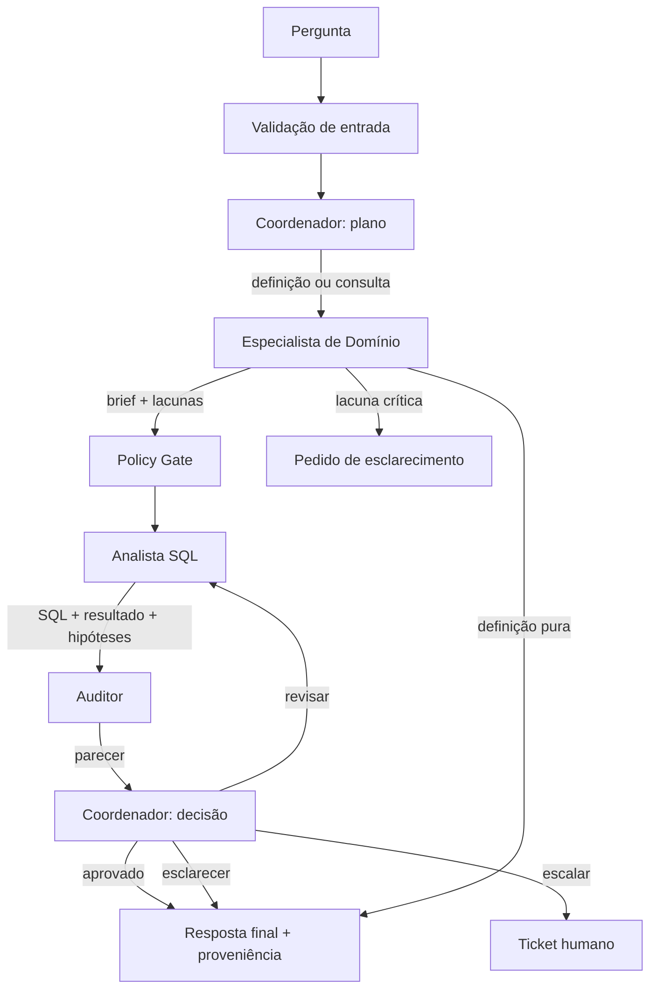

# aurora-multiagente — Orquestração e Evolução para Sistema Multiagente

**Disciplina:** Agentes e Workflows com LLM — Entrega II.

Evolução da Entrega I (`agente-dados-bi`) para um sistema multiagente coordenado
com **LangGraph**, contratos explícitos, trilha de auditoria e preparação para a
governança da Entrega III.

## O que o notebook entrega

- **C1 — baseline:** loop ReAct manual da Entrega I.
- **C2 — orquestração:** o mesmo agente único dentro de um `StateGraph` do
  LangGraph, com estado explícito, checkpoint e auditoria.
- **C3 — decomposição:** Coordenador + Especialista de Domínio + Analista SQL +
  Auditor de Resultados, com envelopes, contratos Pydantic e loop de revisão.
- **Avaliação comparativa** C1 × C2 × C3 em cenários offline determinísticos.
- **Demo real opcional** com OpenRouter, habilitada apenas se houver chave.
- **Testes offline** que rodam sem chave, cobrindo contratos, roteamento,
  revisão, preservação de informação, guardrails, política de PII, orçamento e
  checkpoint.

## Como rodar no Colab

1. Abra `sistema_multiagente_aurora.ipynb` no Google Colab.
2. Configure `OPENROUTER_API_KEY` em **Secrets** (nome exato) ou cole a chave na
   célula de setup apenas na sua sessão. Nunca salve a chave no arquivo.
3. Execute todas as células. Sem chave, a demo real é pulada e os testes offline
   rodam normalmente.
4. A saída mostra o grafo, os testes, a avaliação C1×C2×C3 e, com chave, a demo
   real com a trilha completa.

Único requisito externo: a chave da API do LLM. O data warehouse é SQLite em
memória, criado e semeado dentro do notebook.

## Arquitetura



### Agentes e justificativas

| Agente | Responsabilidade | Ferramentas | Por que é independente |
|---|---|---|---|
| **Coordenador** | Interpretar, planejar, delegar, controlar orçamento e decidir entre responder, revisar ou escalar | Nenhuma ferramenta de dados | Ponto único de decisão e accountability; concentra política, orçamento e resposta final; impede que especialistas ampliem escopo |
| **Especialista de Domínio** | Resolver termos, métricas, tabelas/colunas e ambiguidades; produzir um *brief* estruturado | `inspecionar_schema`, `buscar_documentacao` | Conhecimento semântico é um recurso distinto do raciocínio SQL; evita que o gerador de SQL invente a definição de uma métrica e permite versionar/cachear a camada semântica |
| **Analista SQL** | Formular, executar e corrigir SQL somente leitura; devolver SQL, resultado, hipóteses e erros | `executar_sql` | É a ação de maior risco e tem ciclo próprio de tentativa/erro; permite permissões e limites distintos e testes específicos de SQL |
| **Auditor de Resultados** | Verificar aderência pergunta–SQL–resultado, filtros, período, agregação e plausibilidade; aprovar ou pedir revisão | Checagens determinísticas + LLM | Separação *maker-checker*: quem escreveu o SQL não certifica o próprio resultado; reduz erro semântico silencioso e alucinação |

Não há “um agente por ferramenta”. Guardrails, política de dados e auditoria são
componentes determinísticos. O Analista SQL usa apenas uma ferramenta, mas sua
responsabilidade é mais ampla: interpretar o brief, formular a consulta, executar,
diagnosticar erro e corrigir.

## Contratos de interação

Toda passagem entre agentes usa um envelope com identidade, correlação, remetente,
destinatário, tipo, payload e proveniência. O payload é validado por um schema
Pydantic. Texto livre não é a fonte de verdade: é apenas a explicação.

| Fronteira | Contrato | Campos críticos |
|---|---|---|
| Coordenador → Domínio | `PlanoTarefa` | tipo, objetivo, termos, período, risco |
| Domínio → Analista/Auditor | `BriefDominio` | definições, tabelas, colunas, regras, lacunas, confiança |
| Analista → Auditor | `ArtefatoConsulta` | SQL, resultado, hipóteses, erro, tentativas |
| Auditor → Coordenador | `ParecerVerificacao` | aprovado, motivos, problemas, correção sugerida |
| Coordenador → usuário | `RespostaFinal` | resposta, evidências, SQL, definições, ressalvas |

## Mecanismos de coordenação

- **Supervisor:** o Coordenador decide o próximo passo por *conditional edges*.
- **Loop de revisão:** Auditor reprova → Coordenador envia feedback específico →
  Analista reexecuta, com teto de revisões.
- **Preservação de informação:** SQL, linhas, definições, hipóteses, erros e
  feedback permanecem no estado e nos envelopes; a resposta final cita a
  proveniência.
- **Orçamento:** máximo de tentativas de SQL, revisões e passos por especialista.
- **Auditoria:** log append-only com `correlation_id`, transições e decisões.
- **Checkpoint:** `InMemorySaver` + `thread_id`, permitindo inspecionar e
  reproduzir.
- **Política:** gate antes da ação SQL, com tabelas permitidas e mascaramento de
  PII.

## Por que multiagente é mais adequado?

O agente único da Entrega I concentra quatro trabalhos conflitantes no mesmo
prompt e contexto: interpretar, definir métricas, escrever SQL e verificar o
próprio resultado. Isso produz SQL prematuro sem passar pela definição de negócio,
viés de autoavaliação, contexto inflado, impossibilidade de aplicar permissões
diferentes por papel e dificuldade de auditar “quem decidiu o quê”.

A decomposição separa **conhecimento**, **ação** e **verificação**. O custo é
latência e mais chamadas de LLM; o benefício é contenção de erro e
auditabilidade. Para perguntas triviais, C1/C2 continuam mais baratos; para BI
bancário com dependência semântica e risco de erro silencioso, C3 é mais adequado.

A avaliação offline é um **harness controlado**, não um benchmark estatístico de
qualidade de LLM. Ela mede propriedades arquiteturais e de fluxo.

## Evidências de execução

Execução offline em Python 3.12, `langgraph==1.2.20`, sem chave:

```text
Testes offline
PASS - contratos_e_envelopes
PASS - definicao_pura_sem_sql
PASS - consulta_com_evidencia
PASS - auditor_forca_revisao
PASS - preservacao_nas_fronteiras
PASS - bloqueio_destrutivo
PASS - politica_de_pii
PASS - risco_alto_escala
PASS - orcamento_limita_revisoes
PASS - checkpoint_e_replay
Total: 10 / 10
```

```text
Avaliacao comparativa (harness offline)
------------------------------------------------------------------------------------------------
cenario          C1         C2         C3          C3 passos  C3 SQL  C3 env  C3 rev
------------------------------------------------------------------------------------------------
contagem         sim        sim        sim                 8       1       8       0
definicao        sim        sim        sim                 4       0       4       0
destrutivo       sim        sim        sim                 3       0       3       0
termo_ausente    sim        sim        sim                 4       0       4       0
revisao          n/a        n/a        sim                11       2      11       1
------------------------------------------------------------------------------------------------

Custo por configuracao (passos / SQL / envelopes)
------------------------------------------------------------------------
cenario          C1               C2               C3
------------------------------------------------------------------------
contagem         3/1/0            3/1/3            8/1/8
definicao        2/0/0            2/0/3            4/0/4
destrutivo       2/1/0            2/1/3            3/0/3
termo_ausente    2/0/0            2/0/3            4/0/4
revisao          n/a              n/a              11/2/11
------------------------------------------------------------------------

Propriedades arquiteturais
------------------------------------------------------------------------
propriedade                        C1       C2       C3
------------------------------------------------------------------------
contrato estruturado               nao      nao      sim
envelopes com proveniencia         nao      nao      sim
trilha de auditoria                nao      sim      sim
verificacao independente           nao      nao      sim
politica pre-SQL                   nao      nao      sim
checkpoint/replay                  nao      sim      sim
revisao com feedback               nao      nao      sim
------------------------------------------------------------------------
```

## Preparação para a governança (Entrega III)

| Gancho | Onde está | O que a Entrega III pode adicionar |
|---|---|---|
| Classificação de risco | `PlanoTarefa.risco` | Política de risco configurável, aprovação obrigatória por nível |
| Gate pré-SQL | `node_politica` + `avaliar_politica_sql` | Catálogo de políticas, finalidades permitidas, retenção |
| PII | `mascarar_pii` | Classificação de colunas, tokenização, auditoria de acesso |
| Trilha de auditoria | `auditoria[]` + envelopes | Persistência externa, assinatura, retenção, consulta |
| Checkpoint/replay | `InMemorySaver` + `thread_id` | Checkpointer durável, replay de decisões |
| Aprovação humana | `node_politica` (ponto de extensão) | `interrupt` do LangGraph, fila de aprovação |
| Orçamento | `MAX_REVISOES`, `MAX_TENTATIVAS_SQL` | Custos/tokens, limites por tenant, circuit breaker |

## Estrutura

```text
aurora-multiagente/
├── sistema_multiagente_aurora.ipynb   # entrega principal, Colab-ready
├── README.md                          # arquitetura, justificativas e evidências
├── requirements.txt                   # dependências com versões
└── .gitignore
```

## Limitações

- O DW é sintético e pequeno; os resultados não medem desempenho de produção.
- A avaliação offline é um harness controlado; a demo real depende do modelo e da
  chave do usuário.
- A política de PII cobre o campo `nome` de `clientes`; a Entrega III deve
  classificar todas as colunas e finalidades.
- O checkpointer é em memória; para produção, usar persistência durável.
- Próximos passos: paralelizar subperguntas independentes com `Send`, adicionar
  aprovação humana com `interrupt`, persistir auditoria e criar uma suíte de
  avaliação com LLM real em maior escala.
